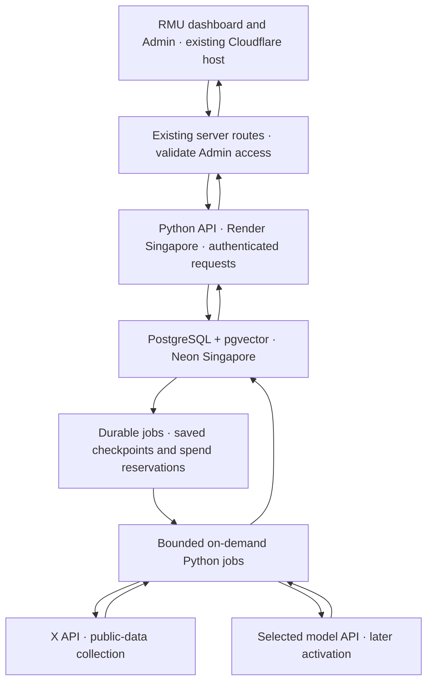

<callout icon="🧭" color="green_bg">
	**Decision brief · Enterprise MVP infrastructure**
	**Baseline:** Gemini’s PostgreSQL, Python, structured inference and historical comparison architecture.
	**Region:** Singapore accepted by Ben in the project conversation.
	**Approved demo direction:** Neon Free PostgreSQL with pgvector and a Render Free Python API in Singapore; bounded on-demand jobs, no always-on worker.
	**Status:** Neon Free database provisioned in Singapore and schema installed. Python API is deployed on Render Free in Singapore and database connectivity is verified. End-to-end synthetic staging proof passed on desktop and mobile. No paid X search or model call has run.
</callout>

<callout icon="📋" color="gray_bg">
	**Prompt review record**
	Ben approved the first pass and reported Jo’s first-pass approval. This records the report accurately; it is not a signed approval of future findings, model validation or publication.
</callout>

<mention-page url="https://app.notion.com/p/3f37b9c99c56802ca9c5de6d24186736"/>
<mention-page url="https://app.notion.com/p/3f97b9c99c5681408d7fda64139d278e"/>

<callout color="blue_bg">
	# 01 · What remains Gemini’s architecture
</callout>

- **Collection:** scheduled or requested jobs query licensed platform APIs.
- **Normalisation:** records carry post ID, platform, timestamp, author, text, engagement and query context.
- **Python:** preprocessing, evidence preparation and historical comparison.
- **Inference:** the versioned system prompt produces structured analytical outputs.
- **PostgreSQL / vector storage:** retained evidence, analysis history and retrieval.
- **Dashboard:** receives approved structured findings and comparable historical changes.

The approved prompt refines analytical rules: code owns measurements, AI interprets supplied evidence, uncertain audience membership remains uncertain, and publication requires review. Those rules fit within this infrastructure.

<callout color="blue_bg">
	# 02 · Hosting options and recommendation
</callout>

## Approved · Low fixed-cost demo

Ben approved Neon Free PostgreSQL plus a Render Free Python API after reviewing the always-on estimate. Singapore is accepted. Gemini's Python, PostgreSQL/vector and structured-analysis architecture is retained.

- **Neon:** confirmed Free organization; project `summer-leaf-91658221`, Singapore, PostgreSQL 17, 0.25 CU maximum configured. Versioned schema and pgvector installed.
- **Render:** Free Python web API, Singapore, sleeping between use. No paid recurring worker or cron created.
- **Processing:** durable PostgreSQL jobs; bounded measurement requests execute on demand. X pages reserve spend before requests and save checkpoints. Model inference remains off.
- **Website:** existing Cloudflare RMU staging deployment, unchanged hosting method.
- **Costs:** no paid hosting tier activated. X/model usage is separate and capped; provider billing remains authoritative. Free-tier limits and cold starts apply.
- **Recovery gate:** source retention/deletion automation and verified off-platform backup/restore must be completed before purchased evidence becomes an operational corpus. Free hosting is a demonstration configuration, not an enterprise availability commitment.

[Neon pricing](https://neon.com/pricing) · [Render Free limitations](https://render.com/docs/free)

The former US$72/month always-on proposal is superseded, not a charge or a required commitment.

<callout color="purple_bg">
	# 03 · How the services connect
</callout>

- The browser never receives database credentials or provider tokens.
- Cloudflare-to-Python requests need service authentication, replay protection, explicit workspace context and restrictive response schemas.
- The database is not exposed as a browser-facing API.
- Durable jobs survive closing the Admin page; uncommitted measurement work rolls back and can be retried.
- Scheduling inserts durable jobs; it does not run a large collection inside a browser request.
- Singapore applies to the new database and Python services. Existing Cloudflare processing and external X/model services have their own locations; this is not an all-data-remains-in-Singapore claim.

<callout color="blue_bg">
	# 04 · Where the posts live
</callout>

**PostgreSQL is the authoritative store for normalised posts and analysis records.** Use ordinary indexed columns for IDs, dates and relations; JSONB for permitted provider fields and structured results.

**Raw responses:** if retention is needed, store permitted response JSON separately with a retrieval timestamp, checksum, retention deadline and collection-page reference. JSONB is not a byte-for-byte archive. If exact response bytes are necessary, use a separate payload field or private object storage; decide that requirement before adding another service.

**Vector representations:** pgvector stores embeddings linked to retained evidence, including embedding model and version. Select the embedding model and dimensions before creating the vector index. Similarity retrieves candidate evidence; it does not prove truth, agreement or representative audience sentiment.

**Deletion:** remove source text, retained payloads, embeddings and cached excerpts together. Mark affected findings unavailable or requiring review. Preserve minimal non-content audit metadata where appropriate. Backup restoration must replay the deletion register before restoring access.

<callout color="blue_bg">
	# 05 · Proposed database structure
</callout>

- **workspaces / memberships:** client identity and roles; tenant separation must be enforced by the API and database permissions.
- **campaign_versions:** campaign name, topic, observation window and configuration snapshots. The current Admin remains in place; each collection captures its exact settings.
- **collection_runs:** provider, evidence lane, query, dates, campaign version, status, coverage and budget.
- **collection_pages:** request identity, checkpoint, maximum reserved cost, confirmed usage and retrieval outcome.
- **posts:** workspace, provider, stable post ID, author ID, timestamp, permitted content, source URL and deletion state.
- **post_observations:** the version of a post and metrics observed at a particular retrieval time; later counts must not overwrite earlier evidence.
- **run_posts:** links collected observations to runs so overlapping searches can reuse evidence without losing provenance.
- **classifications:** record, codebook version, theme, stance, evidence spans and human-review state.
- **analysis_runs:** input references, prompt hash, model/settings, metric-rule version, comparison key and structured output.
- **findings / finding_evidence:** observation or hypothesis, supporting and challenging evidence, limitations, proposed change and test.
- **review_events / publications:** named decisions and the approved result version made visible to a dashboard.
- **jobs / job_attempts:** durable state, lease, retry history, idempotency key and checkpoints.
- **budget_accounts / spend_ledger:** integer monetary units, reservations, charges, uncertain outcomes and reconciliations.
- **deletion_register:** records that must remain removed from active data and restored backups.
- **embeddings:** optional retrieval index linked to retained evidence and model/version.

**Key constraints:** workspace-scoped keys; cross-workspace foreign-key checks; deduplication by provider and stable ID within the workspace; synthetic and observed source types kept separate; no publication without recorded approval; null for missing measurements.

The initial schema is implemented in backend/migrations/001_pipeline.sql. Classification/publication, deletion and recovery workflows remain separate activation gates.

<callout color="yellow_bg">
	# 06 · Reliability and spending rules
</callout>

- **Reserve before requesting:** reserve the maximum expected page cost atomically before sending a paid request.
- **No blind paid retries:** an uncertain network outcome may already have consumed credits. Retain its reservation and reconcile before repeating it.
- **One collection identity:** double-clicking or retrying the same request must not create a second paid run.
- **Checkpoint every page:** persist response and continuation state before progressing.
- **Run caps:** US$50 initial sweep; US$2.50 per test. Include any paid lookups or expansions within the agreed envelope; provider billing remains the authoritative charge record.
- **No automatic top-up changes:** application controls must not silently raise provider limits or enable recharge.
- **Evidence quality:** query coverage, sampling limits, exclusions and missing fields travel with the results.
- **First integration:** use the existing server-side X bearer token for public collection. Client account authorisation remains a separate supported OAuth flow.
- **Identity:** shared Admin access remains an internal-demo limitation. Named users and tenant isolation must be verified before onboarding separate clients.

<callout color="green_bg">
	# 07 · Build and proof sequence
</callout>

1. **Approve hosting direction and inspect exact account costs.** Identify the account owner; create no paid resource until the quote is accepted.
2. **Provision Singapore backend.** Configure least-privilege credentials, database network controls, migrations and recovery.
3. **Prove storage with synthetic fixtures.** Test tenant boundaries, deduplication, deletion, job recovery and backup restoration.
4. **Connect X and preview one collection plan.** Show query, window, evidence lane, maximum spend and retrieval limitations before execution.
5. **Run a bounded pilot within the agreed test allowance.** Inspect real stored records and reconcile usage before the larger sweep.
6. **Activate the analytical implementation in stages.** Classification, computed measures, narrative generation, review and publication each receive their own checks.
7. **Proof the complete experience on RMU staging.** Public dashboard results change only through the approved publication flow.

**Approved direction:** Neon Free plus Render Free in Singapore. Private repository access and deployment are complete; verify the staging pipeline with synthetic evidence before the bounded X pilot. Website deployment continues through the established RMU staging script.

